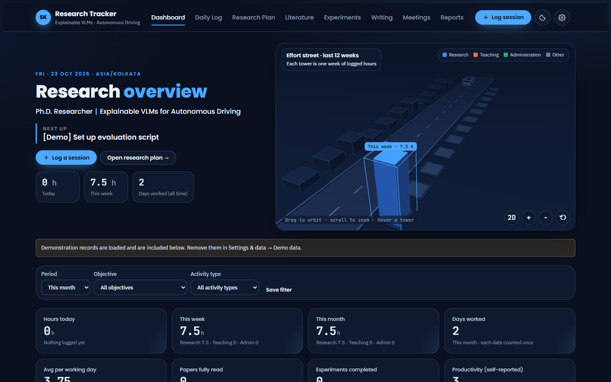
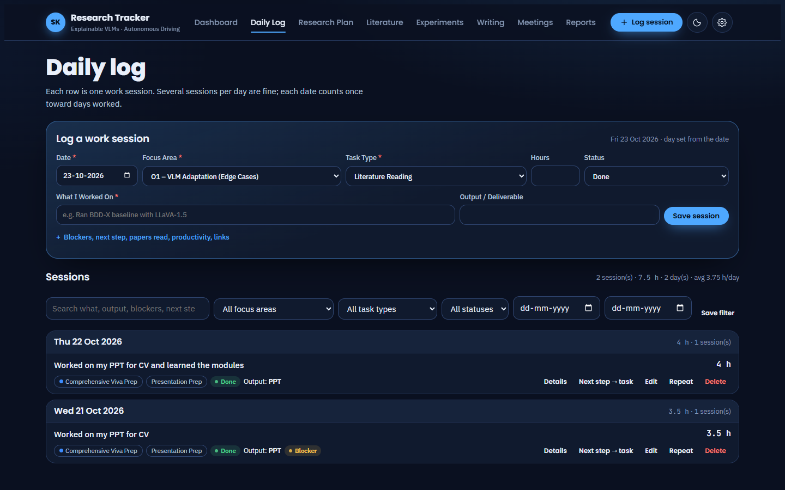
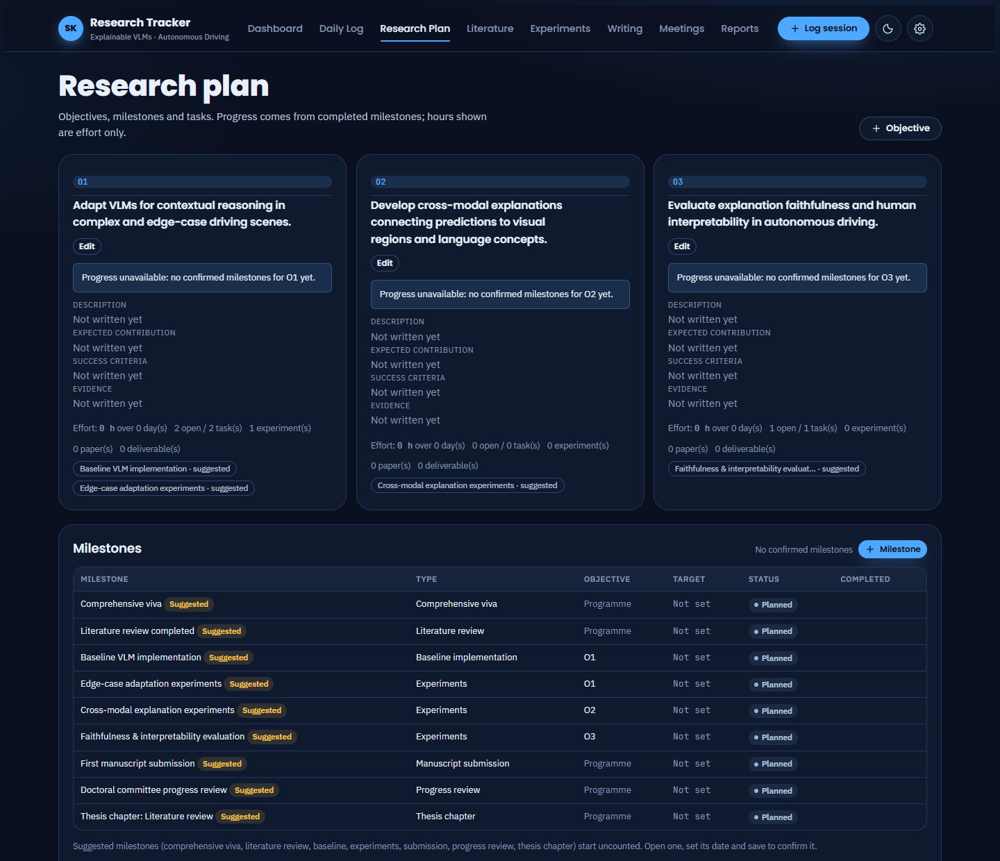
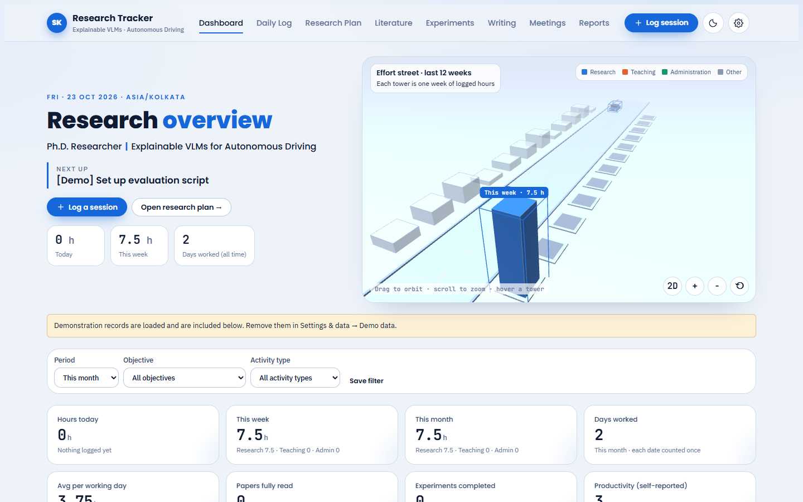
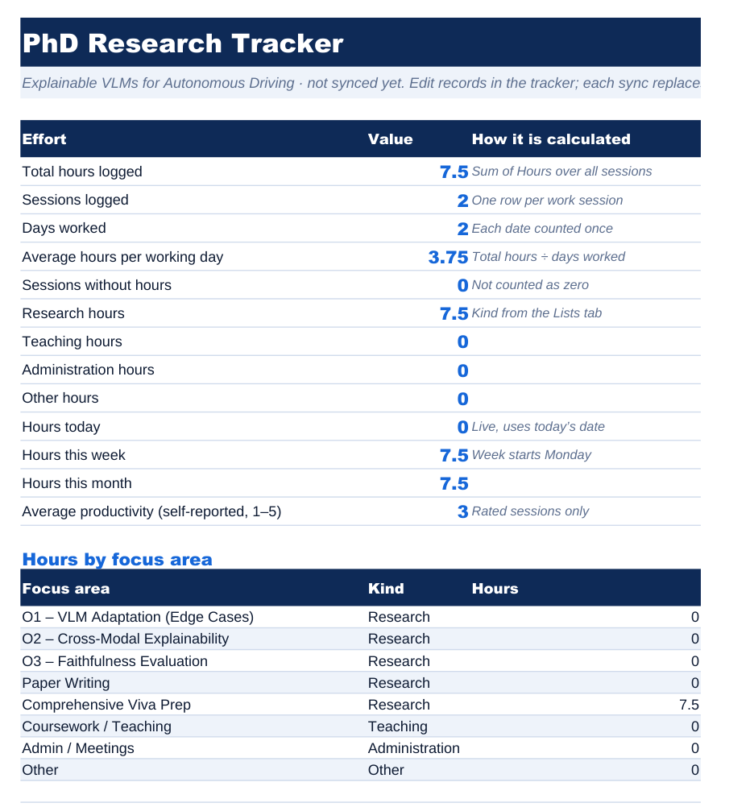
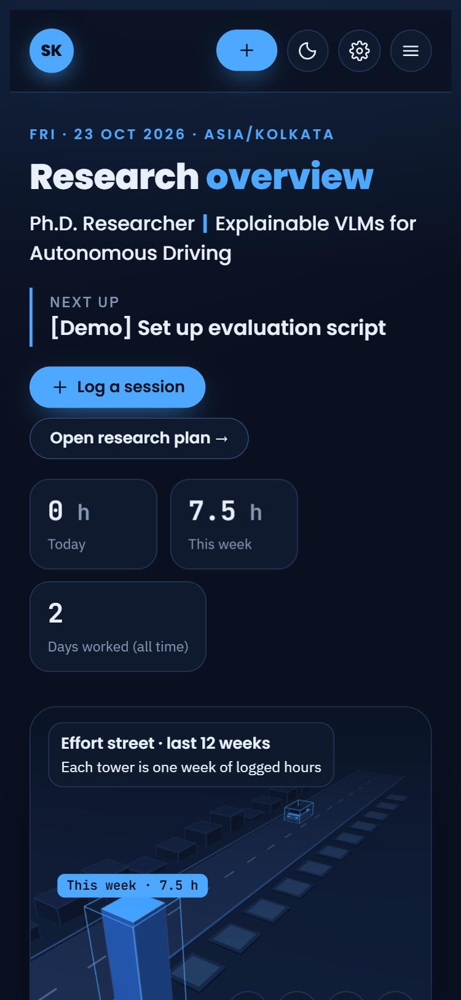
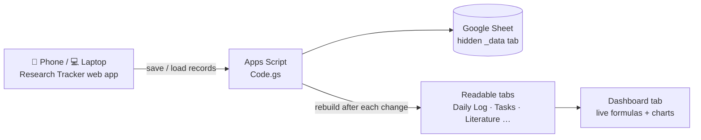

<div align="center">

# 🎓 PhD Research Tracker

**Daily log, research plan, literature, experiments, writing and supervisor meetings in one place,
saved straight into Google Sheets and usable on any device.**

*PhD research on Explainable Vision-Language Models for Autonomous Driving*




</div>

---

## ✨ Features

| | |
|---|---|
| 📊 **Dashboard** | Hours today, this week and this month, days worked, average per working day, task status, objective progress and a 52-week activity heatmap. |
| 🛣️ **3D effort street** | Each of the last 12 weeks is a tower split into research, teaching, admin and other hours. Drag to orbit, or switch to a 2D chart. |
| 📝 **Daily log** | Quick entry for each work session: focus area, task type, hours, output, blockers, next step and productivity. |
| 🎯 **Research plan** | Objectives O1–O3, milestones and tasks as a list, Kanban board or calendar. |
| 📚 **Literature** | Paper library, comparison table, research-gap register, and BibTeX / RIS export. |
| 🧪 **Experiments** | Runs with hypothesis, model, dataset version, split, seed and metrics. Runs are compared only when the setups match. |
| ✍️ **Writing & meetings** | Manuscripts and thesis chapters by stage, plus supervisor meetings whose actions become tasks. |
| 📄 **Reports** | Weekly, monthly and half-yearly reports drafted from your records, with a source for every line. Export to PDF or Excel. |
| ☁️ **Google Sheets storage** | Every entry is written into your own Google Sheet, so you see the same data on every device. |

## 📸 Screenshots

<table>
  <tr>
    <td width="50%"><p align="center"><b>Daily log</b>: one row per work session</p></td>
    <td width="50%"><p align="center"><b>Research plan</b>: objectives, milestones, tasks</p></td>
  </tr>
  <tr>
    <td width="50%"><p align="center"><b>Light theme</b></p></td>
    <td width="50%"><p align="center"><b>Google Sheet</b>: Dashboard tab with live formulas</p></td>
  </tr>
</table>

<p align="center">
  <br>
  <b>On a phone</b>: add the web app to your home screen
</p>

> Screenshots use the tracker's built-in demo records (titles start with **[Demo]**) next to real log entries.

## 🧭 How it works



- Each record is stored as one row in the hidden **`_data`** tab.
- A few seconds after every change, the readable tabs are rebuilt from those rows. The Dashboard tab then recalculates.
- The web app runs as **you** and is visible **only to you**. It works anywhere you are signed in to the same Google account.

## 🚀 Set up the web app

The files are in [`src/dist/gas/`](src/dist/gas/). They are generated by `python build.py`.

1. Open the Google Sheet and choose **Extensions → Apps Script**.
2. Replace the contents of `Code.gs` with [`src/dist/gas/Code.gs`](src/dist/gas/Code.gs).
3. Click **+ → Script**, name it `Lib`, and paste [`src/dist/gas/Lib.gs`](src/dist/gas/Lib.gs).
4. Click **+ → HTML**, name it `Index`, and paste [`src/dist/gas/Index.html`](src/dist/gas/Index.html). Then click **Save**.
5. Choose **Deploy → New deployment → ⚙ → Web app**. Set *Execute as*: **Me** and *Who has access*: **Only myself**, then click **Deploy**.
6. Authorise the script. Google will say the app isn't verified because it is your own script; choose **Advanced → Go to project**. Then copy the **Web app URL**.
7. Open the URL on your phone and choose **Add to Home screen**.

<details>
<summary><b>Copy the large <code>Index.html</code> file to the clipboard (Windows)</b></summary>

```bash
powershell -command "Get-Content -Raw -Encoding UTF8 'src\dist\gas\Index.html' | Set-Clipboard"
```
</details>

<details>
<summary><b>Updating after a code change</b></summary>

1. Run `python build.py` inside `src/`.
2. Paste the changed files into the Apps Script editor.
3. Choose **Deploy → Manage deployments → ✏️ → Version: New version → Deploy**. The URL stays the same.
</details>

## 📐 How progress is calculated

- **Total hours** is the sum of session hours. Blank hours are flagged and never counted as 0.
- **Days worked** is the number of distinct dates with at least one session. **Average** is total hours ÷ days worked for the same period.
- Research, teaching and admin hours are kept apart using each focus area's **kind**.
- **Objective progress** is completed milestones ÷ confirmed milestones. It shows as *unavailable* until a milestone is confirmed. Hours are shown separately, as effort.
- Each task counts once. A log session's status never counts as completing a task.
- A paper counts as **fully read** only when it is marked *Read*. The log's *Papers Read* number is a separate count.

## 🗂️ Project structure

```
Research Tracker/
├── src/
│   ├── core.js          # calculations: hours, days, averages, progress, import, citations, reports
│   ├── store.js         # storage: Google Sheet (web app), Claude artifact db, or browser
│   ├── sheetspec.js     # Google Sheet layout, formulas and formatting
│   ├── gsync.js         # sheet updates and the Google Sheets settings page
│   ├── scene3d.js       # 3D effort street (three.js)
│   ├── views*.js        # dashboard, log, plan, literature, experiments, writing, meetings, reports
│   ├── gas/Code.gs      # Apps Script server: load, save, delete, rebuild tabs
│   ├── build.py         # builds everything into dist/
│   └── dist/
│       ├── gas/         # paste these into Apps Script (Code.gs, Lib.gs, Index.html)
│       ├── index.html   # Claude artifact version
│       └── local.html   # offline single-file version
├── docs/images/         # README screenshots
├── research-tracker.html                          # offline copy (browser storage only)
└── Research Tracker - Google Sheets template.xlsx # styled sheet template
```

## 🧩 Other versions

| Version | Where the data lives | Use it when |
|---|---|---|
| **Google web app** (recommended) | Your Google Sheet | Everyday use on any device |
| [Claude artifact](https://claude.ai/artifact/NKdfxP6Y3RupEM91inCwKW) | Claude's private storage, as a separate copy | Inside claude.ai. Its Google Sheets sync is switched off so it can't overwrite the sheet. |
| `research-tracker.html` | This browser only | Offline use. Move data with **Export & backup → Restore**. |

---

<div align="center">
<sub>Built with plain JavaScript, three.js, SheetJS and jsPDF · Dates use Asia/Kolkata · Weeks start on Monday</sub>
</div>
